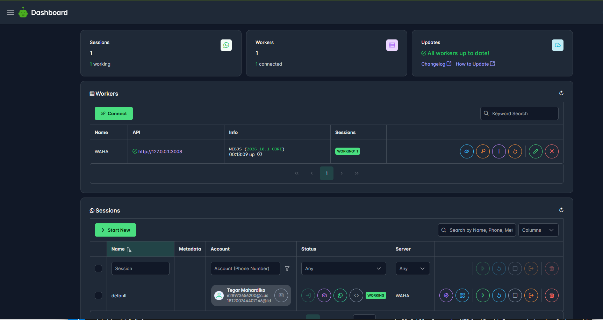
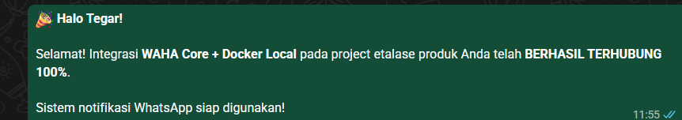
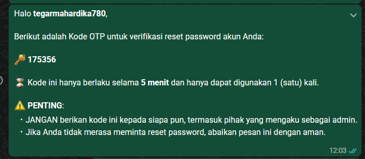
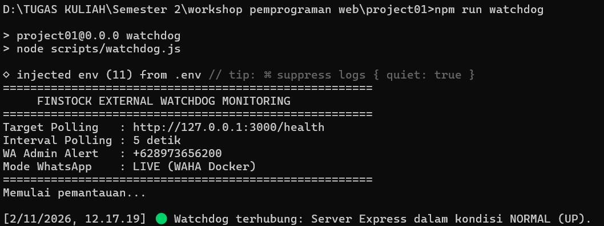
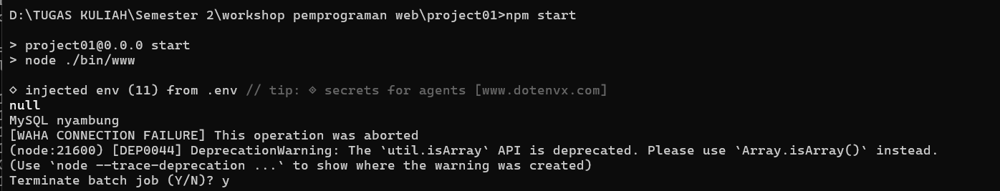
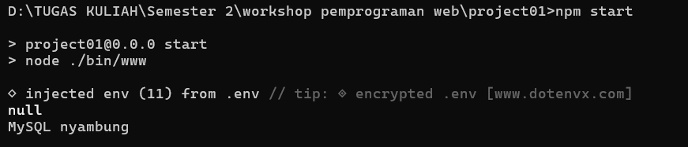
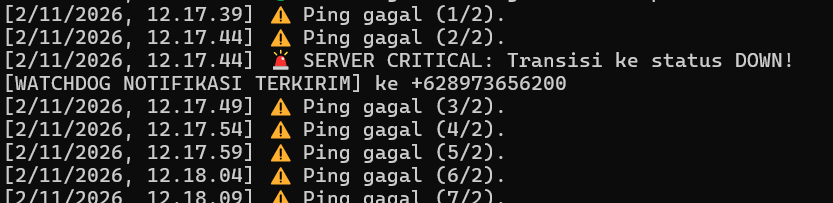
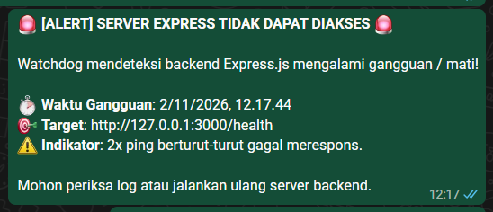
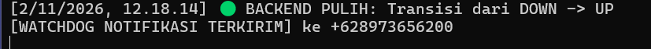
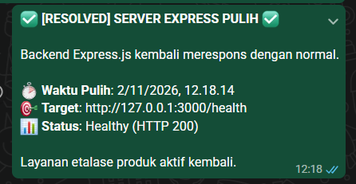

# LAPORAN PRAKTIKUM
## WORKSHOP PEMROGRAMAN WEB (SEMESTER 2)

---

**Topik Praktikum:** Integrasi Layanan Notifikasi WhatsApp (WAHA Core Docker) & Sistem External Watchdog Monitoring pada Backend Express.js  
**Penyusun:** Tegar Mahardika  
**Nomor Kontak Admin / WA:** +628973656200  
**Repository GitHub:** [https://github.com/Gaarrr33/Project01_Express](https://github.com/Gaarrr33/Project01_Express)  

---

## 1. Pendahuluan & Tujuan Praktikum

Pada praktikum kali ini, dilakukan pengembangan arsitektur backend Express.js untuk meningkatkan keandalan sistem (*high availability & reliability*) serta otomasi komunikasi interaktif pengguna melalui integrasi WhatsApp Gateway dan monitoring status server.

### Tujuan Utama:
1. **Penerapan WhatsApp Gateway Mandiri (Self-Hosted):** Menjalankan container Docker WAHA (WhatsApp HTTP API) Core secara lokal dengan persistent session untuk mengotomatiskan pengiriman pesan via WhatsApp.
2. **Implementasi Fitur Otentikasi OTP:** Mengirimkan kode *One-Time Password* (OTP) langsung ke nomor WhatsApp pengguna saat melakukan proses verifikasi reset password.
3. **Penyediaan Endpoint Pemantauan Kesehatan Server:** Menyediakan endpoint `/health` pada aplikasi Express.js sebagai indikator ketersediaan (*liveness check*).
4. **Pengembangan Sistem Monitoring Eksternal (*External Watchdog*):** Membuat skrip `watchdog.js` yang berjalan di luar proses Express.js untuk memantau uptime/downtime server secara periodik (*polling* setiap 5 detik).
5. **Mekanisme Notifikasi Darurat (*Alerting System*):** Menerapkan mekanisme pengiriman notifikasi instan ke WhatsApp Administrator saat server mendeteksi anomali/mati (*DOWN*) dan ketika server pulih kembali (*RESOLVED*), dengan proteksi *anti-false alarm* (threshold 2x gagal) dan *anti-spam* (*state machine*).

---

## 2. Arsitektur & Alur Kerja Sistem

```
+-------------------------------------------------------------+
|                      DOCKER ENGINE                          |
|  +-------------------------------------------------------+  |
|  | Container WAHA Core (Port 127.0.0.1:3008)             |  |
|  | - Engine: WEBJS                                       |  |
|  | - Sesi WA: Tegar Mahardika (628973656200@c.us)        |  |
|  +-------------------------------------------------------+  |
+-------------------------------------------------------------+
               ^                                   ^
               | Kirim Pesan (HTTP API)            | Kirim Alert (HTTP API)
               |                                   |
+------------------------------+     +-------------------------------+
|     BACKEND EXPRESS.JS       |     |  EXTERNAL WATCHDOG SCRIPT     |
|   (Port 127.0.0.1:3000)      |     |     (scripts/watchdog.js)     |
|                              |     |                               |
| - Endpoint Health: /health   | <-- | - Polling Interval: 5 Detik   |
| - Modul OTP Reset Password   |     | - Threshold Gagal: 2x Ping    |
| - Etalase Produk & Auth      |     | - State: UP / DOWN / RESOLVED |
+------------------------------+     +-------------------------------+
               |                                   |
               v                                   v
    [WhatsApp Pengguna / User]             [WhatsApp Administrator]
        (Penerima Pesan OTP)                (Penerima Notifikasi Alert)
```

---

## 3. Komponen & Implementasi Teknis

### A. Konfigurasi Container WAHA Core (`docker-compose.yml`)
WAHA dijalankan menggunakan Docker Compose dengan binding aman khusus ke `127.0.0.1:3008` agar tidak terekspos ke jaringan publik, serta memanfaatkan direktori `./waha-sessions` sebagai persistent storage agar sesi login WhatsApp Web tetap tersimpan saat container di-restart.

```yaml
services:
  waha:
    image: devlikeapro/waha:latest
    container_name: waha_core
    restart: unless-stopped
    environment:
      - WHATSAPP_API_KEY=${WAHA_API_KEY}
      - WAHA_DASHBOARD_USERNAME=${WAHA_DASHBOARD_USERNAME}
      - WAHA_DASHBOARD_PASSWORD=${WAHA_DASHBOARD_PASSWORD}
      - WAHA_LOG_LEVEL=info
      - WHATSAPP_DEFAULT_ENGINE=WEBJS
    ports:
      - "127.0.0.1:3008:3000"
    volumes:
      - ./waha-sessions:/app/.sessions
```

### B. Endpoint Health Check pada Express (`app.js`)
Menyediakan endpoint HTTP GET `/health` yang mengembalikan status respons `200 OK` dan informasi timestamp sistem sebagai target probe bagi watchdog.

### C. Skrip External Watchdog (`scripts/watchdog.js`)
Skrip monitoring ini berjalan independen dari proses server Express.js. Fitur utama yang diimplementasikan:
- **Interval Polling:** Melakukan *probe request* ke `http://127.0.0.1:3000/health` setiap 5 detik.
- **Fail Threshold:** Mengharuskan 2x kegagalan berturut-turut sebelum merubah status menjadi `DOWN`. Hal ini mencegah kepanikan (*false alarm*) saat server hanya di-restart sejenak untuk proses reload kode.
- **State Machine Anti-Spam:** Notifikasi ke WhatsApp Administrator hanya dikirim satu kali pada saat transisi status (`UP -> DOWN` atau `DOWN -> UP`), sehingga admin tidak dibanjiri pesan berulang (*spamming*) selama server tetap mati.

---

## 4. Hasil Pengujian & Dokumentasi Screenshot

Berikut adalah dokumentasi hasil praktikum yang telah berhasil diuji:

### 4.1. Dashboard Manajemen Sesi WAHA Core
Dashboard WAHA diakses melalui peramban web pada alamat `http://127.0.0.1:3008`. Terlihat sesi WhatsApp berstatus `WORKING` dengan nomor admin terhubung (`628973656200@c.us`) serta 1 worker aktif melayani permintaan HTTP API.



---

### 4.2. Pengujian Integrasi Pesan WhatsApp
Pengujian pengiriman pesan awal menggunakan skrip integrasi (`test-whatsapp.js`) membuktikan bahwa backend dapat berkomunikasi dengan container WAHA dan mengirimkan pesan konfirmasi ke nomor WhatsApp tujuan.



---

### 4.3. Implementasi Notifikasi OTP Reset Password
Ketika pengguna meminta reset password pada sistem, backend menghasilkan kode verifikasi 6-digit dengan masa kedaluwarsa 5 menit, dan langsung mengirimkannya via pesan WhatsApp kepada pengguna terkait.



---

### 4.4. Inisialisasi & Pemantauan Normal Watchdog Monitoring
Skrip watchdog dijalankan melalui perintah `npm run watchdog`. Watchdog mendeteksi backend Express.js dalam keadaan aktif (`NORMAL (UP)`).



---

### 4.5. Siklus Server Backend Express.js
Dokumentasi terminal saat menjalankan server Express.js (`npm start`). Menunjukkan koneksi ke database MySQL serta penanganan status koneksi backend.

| Percobaan Koneksi Awal | Server Berjalan Normal (MySQL Connected) |
|---|---|
|  |  |

---

### 4.6. Simulasi Gangguan Server (Status DOWN)
Saat server backend Express dimatikan secara sengaja untuk simulasi gangguan (*crash*):
1. Watchdog mendeteksi kegagalan ping pertama `Ping gagal (1/2)`.
2. Watchdog mendeteksi kegagalan ping kedua `Ping gagal (2/2)` dan memenuhi syarat batas (*threshold*).
3. Terjadi transisi ke status `SERVER CRITICAL: DOWN!`.
4. Notifikasi darurat secara otomatis dikirimkan ke nomor WhatsApp Administrator.



Pesan darurat yang diterima oleh Administrator secara *real-time* di WhatsApp:



---

### 4.7. Pemulihan Server (Status UP / RESOLVED)
Saat server backend Express dinyalakan kembali:
1. Watchdog mendeteksi respons `HTTP 200 OK` dari endpoint `/health`.
2. Terjadi transisi status `BACKEND PULIH: DOWN -> UP`.
3. Watchdog langsung mengirimkan notifikasi resolusi pemulihan ke WhatsApp Administrator.



Pesan pemulihan yang diterima oleh Administrator di WhatsApp:



---

## 5. Analisis & Kesimpulan

1. **Efektivitas WhatsApp Gateway Lokal (WAHA Core):**  
   Penggunaan WAHA Core melalui Docker terbukti sangat andal untuk kebutuhan notifikasi sistem lokal tanpa bergantung pada layanan cloud pihak ketiga yang berbayar, sekaligus menjaga privasi data.

2. **Peningkatan Keamanan pada Fitur OTP:**  
   Pengiriman OTP melalui saluran WhatsApp memberikan alternatif verifikasi instan dengan masa kedaluwarsa ketat (5 menit) dan proteksi *single-use*.

3. **Keandalan Sistem External Watchdog:**  
   Pemisahan proses monitoring dari aplikasi utama (*out-of-process monitoring*) menjamin bahwa jika server Express mengalami *unhandled exception*, *memory leak*, atau prosesnya berhenti (*crash*), pemantauan tetap berjalan dan administrator langsung mendapatkan peringatan instan (*real-time alert*).

4. **Kestabilan Alerting (State Machine & Threshold):**  
   Dengan menerapkan batas toleransi 2x ping gagal dan pelacakan state transisi status, sistem berhasil mencegah *false alarm* saat restart serta meniadakan *spamming* notifikasi pada administrator.

